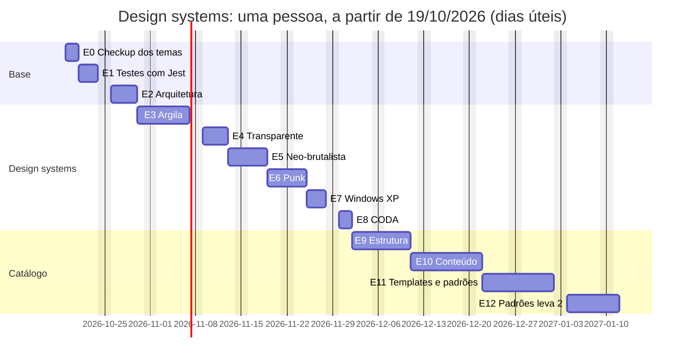

# Plano de execução: design systems, Jest e novo catálogo

Ordem de trabalho para executar a [especificação dos design systems](plano-estilos-paletas-e-catalogo.md). Continua o [plano de execução do design system](plano-de-execucao.md), cujos marcos M0 a M6 já estão prontos.

Ao final deste plano, o Argila tem **seis design systems distintos** (Argila, Neo-brutalista, Punk, Transparente, Windows XP e CODA), cada um o mais fiel possível à sua [imagem de referência](referencias/README.md), testes em **Jest** monitorados em todo PR, um **padrão de arquitetura** verificado no CI e o catálogo novo.

## Como usar este plano

- **Cada marco é um PR**, numa branch própria nascida da `main` atualizada. **Cada item é um commit** dentro dele, com `feat`, `test` e `docs` em commits separados.
- **Marque a caixa** do item quando o commit estiver no PR, e a do marco (na Visão geral) quando o PR for mergeado. Este arquivo é atualizado no próprio PR.
- **Todo PR segue** o [padrão de pipeline](padrao-de-pipeline.md), o [checklist de componente pronto](design-system-proprio.md#checklist-de-um-componente-pronto) e as regras de arquitetura da [especificação, seção 5](plano-estilos-paletas-e-catalogo.md#5-padrão-de-arquitetura).
- **Estimativas** em dias de trabalho de uma pessoa, com testes e documentação. Servem para planejar, não como prazo.
- **Coluna "Depende de":** o item ou marco só começa quando esses estiverem prontos.
- **Marcos de DS** (E3 a E8) terminam com a captura do `pnpm checkup` daquele DS **lado a lado com a imagem de referência**, anexada ao PR. Diferença de propósito vai para a ficha do DS, com o motivo.

## Onde estamos

_Atualizado em 17/10/2026._

| Marco  | Situação                                                                                                                                                                                               |
| ------ | ------------------------------------------------------------------------------------------------------------------------------------------------------------------------------------------------------ |
| PR-1   | **Pronto**: motor de temas (#68), publicado como `0.3.0` (#70)                                                                                                                                         |
| E0     | **Pronto** (#71, #73): barra de tema, checkup completo sem problemas, painéis do Transparente opacos e com desfoque. Falta só a conferência visual das seções 2 a 4 da [validação](validacao-temas.md) |
| E1     | **Pronto** (#74): 700 testes no Jest, resumo e cobertura comparada com a main no CI. A troca do `actions/cache` para a v6 ficou no #75                                                                 |
| E2     | **Pronto** (#77, #79): manifestos, CSS em `tokens/design-systems/`, regras de arquitetura no CI, registro de paletas                                                                                   |
| E3     | **Em andamento**: E3a (paletas) em review                                                                                                                                                              |
| E4–E12 | A fazer                                                                                                                                                                                                |

Detalhes do E0 em [validacao-temas.md](validacao-temas.md#situação).

## Visão geral

| ✓   | Marco | Branch                     | Entrega                                                               | Depende de  | Est. |
| --- | ----- | -------------------------- | --------------------------------------------------------------------- | ----------- | ---- |
| [ ] | E0    | `fix/checkup-de-temas`     | Barra de tema correta, checkup visual completo, painéis legíveis      | PR-1        | 2 d  |
| [ ] | E1    | `chore/testes-com-jest`    | Jest no lugar do Vitest, com resumo e monitoramento dos testes no CI  | E0          | 3 d  |
| [ ] | E2    | `refactor/design-systems`  | Pastas, manifestos e regras de arquitetura; paletas por DS            | E1          | 4 d  |
| [ ] | E3    | `feat/ds-argila`           | DS Argila fiel à referência; paletas compartilhadas; cores; segmentos | E2          | 6 d  |
| [ ] | E4    | `feat/ds-transparente`     | DS Transparente em vidro espesso, o mais perto possível da referência | E3          | 4 d  |
| [ ] | E5    | `feat/ds-neo-brutalista`   | DS Neo-brutalista fiel à referência                                   | E3          | 4 d  |
| [ ] | E6    | `feat/ds-punk`             | DS Punk fiel à referência                                             | E3          | 4 d  |
| [ ] | E7    | `feat/ds-windows-xp`       | DS Windows XP fiel à referência                                       | E3          | 3 d  |
| [ ] | E8    | `feat/ds-coda`             | CODA como sexto DS, com núcleo mínimo curado                          | E3          | 2 d  |
| [ ] | E9    | `feat/catalogo-estrutura`  | Navegação nova, catálogo filtrado pelo DS, páginas em abas            | E2          | 7 d  |
| [ ] | E10   | `feat/catalogo-conteudo`   | Páginas dos DS, Como começar, Fundação, Montar tema, anatomia         | E4 a E8, E9 | 7 d  |
| [ ] | E11   | `feat/templates-e-padroes` | 5 templates, padrões da leva 1, variantes                             | E9          | 9 d  |
| [ ] | E12   | `feat/padroes-leva-2`      | Padrões da leva 2                                                     | E11         | 6 d  |

**Total:** cerca de 61 dias de trabalho de uma pessoa (perto de 3 meses). Depois do E2, há duas frentes: **DS** (E3, depois E4 a E8 em qualquer ordem ou em paralelo) e **catálogo** (E9, depois E11 e E12). Com duas pessoas, perto de 7 semanas.

O gráfico mostra uma pessoa fazendo tudo em sequência. A data de início é só referência; ajuste ao começar.

---

## Decisões

Respondidas em 17/10/2026.

| #    | Decisão                                                                   | Resposta                                                                                                   |
| ---- | ------------------------------------------------------------------------- | ---------------------------------------------------------------------------------------------------------- |
| E-D1 | Paleta padrão do Argila                                                   | **Massinha** (menta, da referência). Terrosa continua como paleta aceita                                   |
| E-D2 | Windows XP com as cores do "Retro-OS UI Kit" e fonte em pixel nos títulos | **Sim**, com aviso no changelog                                                                            |
| E-D3 | O que fazer com CODA e Molde                                              | **CODA vira o sexto DS** (marco E8). Molde fica como base interna para criar DS                            |
| E-D4 | Referência visual para o Transparente                                     | **Imagem recebida** ([transparente.jpg](referencias/transparente.jpg)): o mais próximo possível (marco E4) |
| E-D5 | Versão das mudanças visuais                                               | **`0.4.0`** (minor), com o caminho para manter o visual anterior no changelog                              |
| E-D6 | Imagens de terceiros versionadas em `docs/referencias/`                   | **Sim**, só para consulta; fora do pacote e do catálogo publicado                                          |

---

## E0: checkup dos temas

Tarefa à parte, aberta depois do PR-1, já em andamento. Lista detalhada em [validacao-temas.md](validacao-temas.md).

| ✓   | ID    | Item                                                                                    | Depende de | Pronto quando                                                             | Est. |
| --- | ----- | --------------------------------------------------------------------------------------- | ---------- | ------------------------------------------------------------------------- | ---- |
| [x] | CK-01 | `fix(docs): seletores de estilo e paleta mostram o que está aplicado`                   | —          | Recarregar a página mantém e mostra estilo e paleta                       | —    |
| [x] | CK-02 | `test(tokens): estrutura dos temas` e `test(docs): barra de tema`                       | CK-01      | Remover um estilo ou paleta do CSS faz o teste falhar                     | —    |
| [x] | CK-03 | `test(docs): checkup visual de cada página em cada tema` (`npm run checkup`)            | —          | Gera `checkup/relatorio.html` sem travar numa página parada               | —    |
| [x] | CK-04 | Rodada completa do checkup e triagem do relatório                                       | CK-03      | Todas as combinações capturadas; cada problema marcado como real ou falso | 0,5  |
| [x] | CK-05 | `fix(tokens): painéis do Transparente mais opacos e com desfoque`                       | CK-04      | Calendário, Dialog, Menu e Toast legíveis sobre qualquer conteúdo         | 1    |
| [x] | CK-06 | Correções do que o CK-04 encontrar e [lista de validação](validacao-temas.md) conferida | CK-04      | Lista inteira marcada; PR aberto e mergeado por rebase                    | 0,5  |

Os testes do E0 são escritos em Vitest e migram junto com o resto no E1. O CK-05 é a correção mínima; o visual completo do Transparente vem no E4.

---

## E1: testes com Jest

Especificação: [seção 6](plano-estilos-paletas-e-catalogo.md#6-testes-com-jest).

| ✓   | ID   | Item                                                                                                                                                                                                                                                                    | Depende de | Pronto quando                                                                                                               | Est. |
| --- | ---- | ----------------------------------------------------------------------------------------------------------------------------------------------------------------------------------------------------------------------------------------------------------------------- | ---------- | --------------------------------------------------------------------------------------------------------------------------- | ---- |
| [x] | J-01 | `chore(test): jest na raiz` (`jest`, `jest-preset-angular`, `jest-environment-jsdom`, `ts-jest`, `@types/jest`; `jest.config.mjs` em ESM com os projetos ui, docs e scripts; `setupZonelessTestEnv`)                                                                    | E0         | `pnpm jest --selectProjects ui -t Button` roda o spec do Button                                                             | 0,5  |
| [x] | J-02 | `test: migra os specs do ui para o Jest` (`vi.*` → `jest.*`, sem `import from 'vitest'`)                                                                                                                                                                                | J-01       | Todos os specs do ui passam no Jest, com a mesma quantidade de testes que no Vitest                                         | 0,5  |
| [x] | J-03 | `test: migra os specs do catálogo e dos scripts para o Jest`                                                                                                                                                                                                            | J-01       | Idem para docs e scripts; `scripts/vitest.config.ts` removido                                                               | 0,5  |
| [x] | J-04 | `chore: remove o Vitest` (dependências, targets `test` do `angular.json`; scripts `test`, `test:watch`, `test:ui`, `test:docs`, `test:scripts`, `test:coverage`; `lint-staged` com `--findRelatedTests`)                                                                | J-02, J-03 | `grep -ri vitest` não acha nada fora do changelog; `pnpm test` falha abaixo de 80%                                          | 0,5  |
| [x] | J-05 | `chore(lint): eslint-plugin-jest` (`recommended`, `no-focused-tests` como erro, `no-disabled-tests` como aviso)                                                                                                                                                         | J-04       | Um `it.only` faz o `pnpm lint` falhar                                                                                       | 0,25 |
| [x] | J-06 | `feat(scripts): relatório de testes` (`scripts/relatorio-de-testes.ts` e `pnpm test:report`: totais, duração, cobertura por projeto, 10 mais lentos, diferença para a main)                                                                                             | J-04       | Testado com 80%+ a partir de `junit.xml` e `coverage-summary.json` de exemplo                                               | 0,5  |
| [x] | J-07 | `ci: resumo e monitoramento dos testes` (job summary; artefato `testes` com `reports/` e `coverage/` por 14 dias; cobertura da main em cache e `historico.csv` no artefato `cobertura-main`; aviso para teste acima de 2s; falha se a cobertura cair mais de 0,5 ponto) | J-06       | Um PR de teste mostra o resumo; tirar um teste derruba a cobertura e o `verify` falha                                       | 0,5  |
| [x] | J-08 | `docs: testes com Jest no README e no design system próprio`                                                                                                                                                                                                            | J-07       | README, [design-system-proprio.md](design-system-proprio.md) e [padrão de pipeline](padrao-de-pipeline.md) falam só de Jest | 0,25 |

---

## E2: arquitetura dos design systems

Os manifestos cobrem os 5 DS que já têm CSS (Argila, Molde, CODA, Transparente e Windows XP). Neo-brutalista e Punk ganham o deles nos marcos E5 e E6, junto com o CSS. As paletas aceitas continuam `nativa` e `terrosa` em todos: as listas da especificação (3.6) entram no E3, com as paletas compartilhadas.

Especificação: [seção 5](plano-estilos-paletas-e-catalogo.md#5-padrão-de-arquitetura) e [3.6](plano-estilos-paletas-e-catalogo.md#36-paletas-por-ds-d19).

| ✓   | ID   | Item                                                                                                                                                                                       | Depende de | Pronto quando                                                                                 | Est. |
| --- | ---- | ------------------------------------------------------------------------------------------------------------------------------------------------------------------------------------------ | ---------- | --------------------------------------------------------------------------------------------- | ---- |
| [x] | A-01 | `feat(theme): manifestos dos design systems` (`ArgDesignSystem` com `as const satisfies`, `ArgStyle`, `ArgPaletteOf`, `ARG_COMPONENTS`, núcleo mínimo)                                     | E1         | Paleta não aceita num segmento não compila; testes do `defineDesignSystem` com 95%+           | 1    |
| [x] | A-02 | `refactor(tokens): pastas design-systems/` (move `styles/` e `palettes/nativas/` para `design-systems/<ds>/forma.css` e `paletas/nativa.css`; caminhos antigos reencaminham para os novos) | A-01       | Nenhuma mudança visual no `pnpm checkup`; pacote publicado com os mesmos seletores            | 1    |
| [x] | A-03 | `feat(theme): ArgTheme respeita o manifesto` (paleta, cores, modo e transparência que o DS não aceita voltam ao padrão, com aviso em desenvolvimento)                                      | A-01       | Trocar de Argila com Terrosa para Punk aplica a paleta Néon e avisa no console                | 0,5  |
| [x] | A-04 | `test(tokens): contraste só nas combinações aceitas`                                                                                                                                       | A-02       | A matriz vem dos manifestos; aceitar uma paleta nova num DS entra no teste sem mexer no teste | 0,5  |
| [x] | A-05 | `ci: regras de arquitetura` (`dependency-cruiser`, `pnpm arch:check`, `arquitetura.spec.ts`; o prefixo dos exclusivos é conferido pelo teste, a partir do manifesto)                       | A-02       | Cada regra da 5.4 tem um caso que a viola e faz o CI falhar                                   | 0,75 |
| [x] | A-06 | `docs: arquitetura e como criar um DS`                                                                                                                                                     | A-05       | README e catálogo explicam as camadas; o passo a passo da 5.5 funciona copiando o Molde       | 0,25 |

---

## E3: DS Argila, paletas, cores e segmentos

O E3 sai em cinco PRs, para cada um ficar revisável: **E3a** paletas (AR-01, PA-01), **E3b-1** forma, elevação e pele do núcleo mínimo (AR-02, AR-03, AR-05), **E3b-2** abas segmentadas e chips (AR-04), **E3c-1** cores de marca (CO-01) e **E3c-2** segmentos (SG-01).

Referência: [argila.jpg](referencias/argila.jpg). Ficha: [3.4](plano-estilos-paletas-e-catalogo.md#34-ficha-de-cada-ds).

| ✓   | ID    | Item                                                                                                                                                                                                                                                    | Depende de | Pronto quando                                                                                   | Est. |
| --- | ----- | ------------------------------------------------------------------------------------------------------------------------------------------------------------------------------------------------------------------------------------------------------- | ---------- | ----------------------------------------------------------------------------------------------- | ---- |
| [x] | AR-01 | `feat(tokens): paleta Massinha como padrão do Argila`                                                                                                                                                                                                   | E2         | Sem atributo nenhum, o Argila aparece em menta e quase branco, como na referência; contraste AA | 0,5  |
| [x] | AR-02 | `feat(argila): forma de massinha` (pílula, raio de 20px, sombra difusa + realce interno, campos rebaixados, foco com brilho menta)                                                                                                                      | AR-01      | Lado a lado com a referência: botões, busca, chips, alertas e card com a mesma forma            | 1,5  |
| [x] | AR-03 | `feat(argila): 5 níveis de elevação`                                                                                                                                                                                                                    | AR-02      | `--arg-shadow-1` a `-5` documentados e visíveis como na pilha da referência                     | 0,5  |
| [x] | AR-04 | `feat(tabs,tag): abas segmentadas e chips selecionáveis` (variantes da 4.7)                                                                                                                                                                             | AR-02      | `variant="segmented"` e `selectable` funcionam em todos os DS; teclado e ARIA testados          | 1    |
| [x] | AR-05 | `feat(argila): núcleo mínimo curado`                                                                                                                                                                                                                    | AR-02      | Os 19 componentes do núcleo mínimo com pele própria e teste no Argila                           | 1    |
| [x] | PA-01 | `feat(tokens): paletas compartilhadas` (Terrosa vira arquivo; Oceano, Floresta, Viva, Preto e branco, Alto contraste em AAA). A Pastel entra no E5, com o Neo-brutalista, que é o único que a aceita; o feedback dessaturado da Terrosa fica para o E3b | E2         | Cada paleta passa no contraste em todos os DS que a aceitam (AAA no Alto contraste)             | 0,5  |
| [x] | CO-01 | `feat(theme): lista fixa de cores e setColors` (`colors.css` e `colors.generated.ts` gerados por `pnpm colors`, conferidos no CI)                                                                                                                       | PA-01      | Cor que falha num par DS × paleta não aparece nem compila nesse par                             | 0,5  |
| [x] | SG-01 | `feat(theme): segmentos` (`provideArgila`, `setSegment`, `argSegmentAttributes`; sem gerador de CSS, ver 3.8)                                                                                                                                           | CO-01      | Os três segmentos de exemplo aplicam tudo de uma vez; o CSS gerado dá o mesmo resultado         | 0,5  |

O E3 abre a `0.4.0` (changeset minor) e o changelog explica como manter o visual anterior.

## E4: DS Transparente

Referência: [transparente.jpg](referencias/transparente.jpg). É uma renderização 3D: a ficha diz o que o CSS imita e o que fica de fora.

| ✓   | ID    | Item                                                                                                                                                                               | Depende de | Pronto quando                                                                                      | Est. |
| --- | ----- | ---------------------------------------------------------------------------------------------------------------------------------------------------------------------------------- | ---------- | -------------------------------------------------------------------------------------------------- | ---- |
| [ ] | TR-01 | `feat(transparente): paleta Vidro e forma de vidro espesso` (pílulas de 56px, raios de 16 e 24px, aro claro, brilho especular, sombra com reflexo colorido, botões em gradiente)   | E3         | Botões, busca, select, switch, abas, toast, card e popover com a mesma forma da referência         | 1    |
| [ ] | TR-02 | `feat(transparente): borda iridescente e alternativas` (`::before` com `conic-gradient` e `mask`; sem `backdrop-filter`, com `prefers-reduced-transparency` e com `forced-colors`) | TR-01      | As três alternativas testadas: vidro vira superfície opaca com borda simples, sem perder contraste | 0,75 |
| [ ] | TR-03 | `feat(transparente): painéis sobre o conteúdo e modo escuro` (Dialog, Popover, Menu e Toast presos em 80% abaixo de 50%; vidro fumê testado e decidido)                            | TR-01      | Texto de trás nunca aparece; escuro aprovado, ou o manifesto declara só claro com o motivo         | 0,5  |
| [ ] | TR-04 | `feat(transparente): núcleo mínimo e curados da matriz` (Combobox, Drawer, Menu, Popover)                                                                                          | TR-01      | Os 19 do núcleo e os 4 da matriz com pele e teste no Transparente                                  | 1    |
| [ ] | TR-05 | `feat(input): ação acoplada` (`argInputAction`, como o **+** da busca da referência)                                                                                               | TR-01      | Funciona em todos os DS; o botão tem nome acessível e entra na ordem de foco                       | 0,5  |
| [ ] | TR-06 | `docs(transparente): capturas lado a lado com a referência`                                                                                                                        | TR-03      | Capturas anexadas ao PR; regras de uso e limites do CSS na página do DS                            | 0,25 |

## E5: DS Neo-brutalista

Referência: [neo-brutalista.jpg](referencias/neo-brutalista.jpg).

| ✓   | ID    | Item                                                                                                                                         | Depende de | Pronto quando                                                                                             | Est. |
| --- | ----- | -------------------------------------------------------------------------------------------------------------------------------------------- | ---------- | --------------------------------------------------------------------------------------------------------- | ---- |
| [ ] | NB-01 | `feat(neo-brutalista): manifesto, forma, tipografia e paleta Papel CMY` (contorno de 3px, sombra dura, escala de espaçamento, Archivo Black) | E3         | Escala de títulos 96/64/48/32 e espaçamentos 4–96 como na referência                                      | 1    |
| [ ] | NB-02 | `feat(neo-brutalista): núcleo mínimo e curados da matriz` (Avatar, Breadcrumb, List, Pagination, Stepper, Table)                             | NB-01      | Botões, inputs, controles, abas, steps, paginação, tabela, toasts, modal e empty state como na referência | 1,5  |
| [ ] | NB-03 | `feat(neo-brutalista): exclusivos arg-nb-sticker e arg-nb-rules`                                                                             | NB-01      | Selo inclinado legível por leitor de tela; caixa de regras com as regras do manifesto                     | 0,75 |
| [ ] | NB-04 | Modo escuro: testar, decidir e registrar                                                                                                     | NB-02      | Escuro aprovado, ou o manifesto declara só claro e o motivo vai para a especificação                      | 0,25 |
| [ ] | NB-05 | `docs(neo-brutalista): capturas lado a lado com a referência`                                                                                | NB-04      | Capturas anexadas ao PR; regras de uso na página do DS                                                    | 0,5  |

## E6: DS Punk

Referência: [punk.jpg](referencias/punk.jpg).

| ✓   | ID    | Item                                                                                                                                | Depende de | Pronto quando                                                                               | Est. |
| --- | ----- | ----------------------------------------------------------------------------------------------------------------------------------- | ---------- | ------------------------------------------------------------------------------------------- | ---- |
| [ ] | PK-01 | `feat(punk): manifesto, forma, tipografia e paleta Néon` (fundo preto, cards chapados com raio de 24px, pílulas brancas, Unbounded) | E3         | Tela de entrada e home de exemplo com a mesma forma da referência                           | 1    |
| [ ] | PK-02 | `feat(punk): núcleo mínimo e curados da matriz` (Agenda, Avatar, Date Picker, Drawer, List, Table, Time Slots)                      | PK-01      | Calendário em faixa, chips, listas com chevron, conversas e notificações como na referência | 1,5  |
| [ ] | PK-03 | `feat(punk): exclusivos arg-punk-stat-card, arg-punk-dot-track e arg-punk-burst`                                                    | PK-01      | Trilha de pontos acessível como `progressbar`; estrela só decorativa (`aria-hidden`)        | 1    |
| [ ] | PK-04 | Modo claro: testar, decidir e registrar                                                                                             | PK-02      | Claro aprovado, ou o manifesto declara só escuro e o motivo vai para a especificação        | 0,25 |
| [ ] | PK-05 | `docs(punk): capturas lado a lado com a referência`                                                                                 | PK-04      | Capturas anexadas ao PR; regras de uso na página do DS                                      | 0,25 |

## E7: DS Windows XP

Referência: [windows-xp.jpg](referencias/windows-xp.jpg).

| ✓   | ID    | Item                                                                                                                              | Depende de | Pronto quando                                                                               | Est. |
| --- | ----- | --------------------------------------------------------------------------------------------------------------------------------- | ---------- | ------------------------------------------------------------------------------------------- | ---- |
| [ ] | XP-01 | `feat(windows-xp): paleta Retro, Pixelify Sans e fundo com linhas de varredura` (bordas de 1px, raio 0 ou 4px, bisel de 1px)      | E3         | Cores, títulos e bordas como na referência; contraste AA                                    | 0,75 |
| [ ] | XP-02 | `feat(windows-xp): núcleo mínimo curado e Menu` (botões, progresso, campo de comando, abas em pasta, checkbox, modal OK/Cancelar) | XP-01      | Componentes da referência com a mesma aparência                                             | 1    |
| [ ] | XP-03 | `feat(windows-xp): exclusivos arg-xp-window e arg-xp-balloon`                                                                     | XP-01      | Janela com minimizar, maximizar e fechar acessíveis por teclado; balão anunciado como toast | 0,75 |
| [ ] | XP-04 | `feat(icons): ícones em grade de pixel de 16px e 24px no Windows XP`                                                              | XP-01      | Os ícones do primeiro lote aparecem em pixel no Windows XP, sem SVG novo por ícone          | 0,25 |
| [ ] | XP-05 | `docs(windows-xp): capturas lado a lado com a referência e aviso no changelog`                                                    | XP-02      | Capturas anexadas; changeset explica a troca do azul-marinho                                | 0,25 |

## E8: DS CODA

Sem imagem de referência: a ficha parte do visual atual. Quando chegar uma imagem, ela entra em `docs/referencias/coda.jpg` e vira um item novo aqui.

| ✓   | ID    | Item                                                                                                                           | Depende de | Pronto quando                                                                 | Est. |
| --- | ----- | ------------------------------------------------------------------------------------------------------------------------------ | ---------- | ----------------------------------------------------------------------------- | ---- |
| [ ] | CD-01 | `feat(coda): manifesto completo` (paletas aceitas Viva, Preto e branco e Alto contraste; regras de uso; sem transparência)     | E3         | CODA aparece como DS no `ArgTheme` e na matriz de contraste, com as 4 paletas | 0,5  |
| [ ] | CD-02 | `feat(coda): núcleo mínimo curado` (Silkscreen em todos os componentes, tamanhos ajustados, quebra de linha em rótulos longos) | CD-01      | Os 19 do núcleo sem texto cortado nem estouro em 320px de largura             | 1    |
| [ ] | CD-03 | `docs(coda): ficha e capturas`                                                                                                 | CD-02      | Página do DS com ficha, paletas e regras; capturas anexadas ao PR             | 0,5  |

---

## E9: estrutura do catálogo

Especificação: [seção 4](plano-estilos-paletas-e-catalogo.md#4-catálogo).

| ✓   | ID   | Item                                                                                                                            | Depende de | Pronto quando                                                                                   | Est. |
| --- | ---- | ------------------------------------------------------------------------------------------------------------------------------- | ---------- | ----------------------------------------------------------------------------------------------- | ---- |
| [ ] | C-01 | `feat(icons): ícones da navegação` (`book`, `rocket`, `layers`, `layout`, `wrench`, `help-circle`, `accessibility`, `sparkles`) | E2         | Os 8 passam no gerador                                                                          | 0,5  |
| [ ] | C-02 | `feat(docs): barra de ícones e painel` (busca no painel, gaveta no celular)                                                     | C-01       | Navegável só por teclado; painel fecha com Esc e clique fora                                    | 1,5  |
| [ ] | C-03 | `feat(docs): DocPage novo e famílias de componentes`                                                                            | E2         | Campos opcionais da 4.4; componentes agrupados nas 9 famílias                                   | 1    |
| [ ] | C-04 | `feat(docs): catálogo filtrado pelo DS` (fora some, herdado avisa, "Disponível em")                                             | C-03       | Trocar para Windows XP esconde a Agenda; abrir a URL dela mostra o aviso com os DS que a têm    | 1    |
| [ ] | C-05 | `feat(docs): páginas em abas, "Atualizado em" e índice`                                                                         | C-03       | Aba ativa na URL; data vem do último commit do `*.docs.ts`                                      | 1,5  |
| [ ] | C-06 | `feat(docs): barra de tema por DS` (só opções aceitas; URL e navegador; link inválido cai no padrão)                            | C-04       | Escolher Punk mostra só Néon, Viva e Alto contraste; o link compartilhado reproduz a combinação | 1    |
| [ ] | C-07 | `feat(docs): categorias Design systems e Templates`                                                                             | C-03       | As duas aparecem na navegação, ainda com páginas "Sobre"                                        | 0,5  |

## E10: conteúdo do catálogo

| ✓   | ID   | Item                                                                                           | Depende de  | Pronto quando                                                                        | Est. |
| --- | ---- | ---------------------------------------------------------------------------------------------- | ----------- | ------------------------------------------------------------------------------------ | ---- |
| [ ] | K-01 | `docs: páginas dos 6 design systems` (ficha da 3.4 gerada do manifesto, matriz de componentes) | E4 a E8, E9 | Mudar o manifesto muda a página, sem texto duplicado                                 | 1,5  |
| [ ] | K-02 | `docs: Como começar e Acessibilidade`                                                          | E9          | Seguir "Como começar" num projeto vazio chega ao primeiro componente com um segmento | 1    |
| [ ] | K-03 | `docs: Fundação` (Cores, Tipografia, Espaçamento, Raio e elevação, Movimento)                  | E9          | Cada página mostra os valores do DS e da paleta escolhidos                           | 1,5  |
| [ ] | K-04 | `docs: Atualizações e Ajuda`                                                                   | E9          | Changelog renderizado; perguntas frequentes e como contribuir                        | 0,5  |
| [ ] | K-05 | `feat(docs): Montar tema`                                                                      | E9          | Copiar o segmento ou o CSS e colar num produto reproduz o que se vê                  | 1    |
| [ ] | K-06 | `docs: anatomia dos 10 componentes`                                                            | E9          | Marcadores acompanham DS e paleta; legenda lida pelo leitor de tela                  | 1,5  |

## E11: templates e padrões, leva 1

| ✓   | ID   | Item                                                                                 | Depende de | Pronto quando                                                                            | Est. |
| --- | ---- | ------------------------------------------------------------------------------------ | ---------- | ---------------------------------------------------------------------------------------- | ---- |
| [ ] | T-01 | `docs: os 5 templates` (Empty State, Ending Screen, Error Message, Loaders, Receipt) | E9         | Cada template funciona nos 6 DS só com o núcleo mínimo                                   | 3,5  |
| [ ] | T-02 | `feat: variantes da 4.7` (paginação em pontos, stepper vertical, drawer de baixo)    | E9         | Variantes testadas e com exemplos                                                        | 2    |
| [ ] | T-03 | `docs: padrões da leva 1` (8 páginas no formato fixo)                                | T-02       | Toda página segue Problema → Solução → Exemplo → Variações → Faça/não faça → Componentes | 3,5  |

## E12: padrões, leva 2

| ✓   | ID   | Item                                                   | Depende de | Pronto quando                        | Est. |
| --- | ---- | ------------------------------------------------------ | ---------- | ------------------------------------ | ---- |
| [ ] | P-01 | `docs: padrões da leva 2` (10 páginas no formato fixo) | E11        | As 10 páginas publicadas no catálogo | 6    |

---

## Acompanhamento

- **Semanal:** revisar este plano no time: o que atrasou, o que mudou de prioridade, se alguma estimativa precisa ser corrigida.
- **A cada marco de DS:** comparar as capturas com a imagem de referência antes do merge.
- **A cada PR:** conferir o resumo de testes do CI (cobertura em relação à `main`, testes lentos e pulados).
- **Sugestão:** uma issue por ID (`[TR-02] borda iridescente`) num Project com as colunas A fazer, Em andamento, Em review e Feito.
