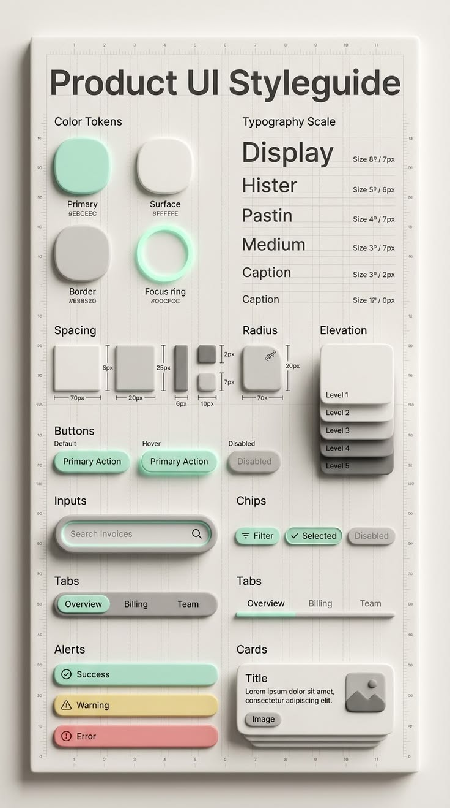
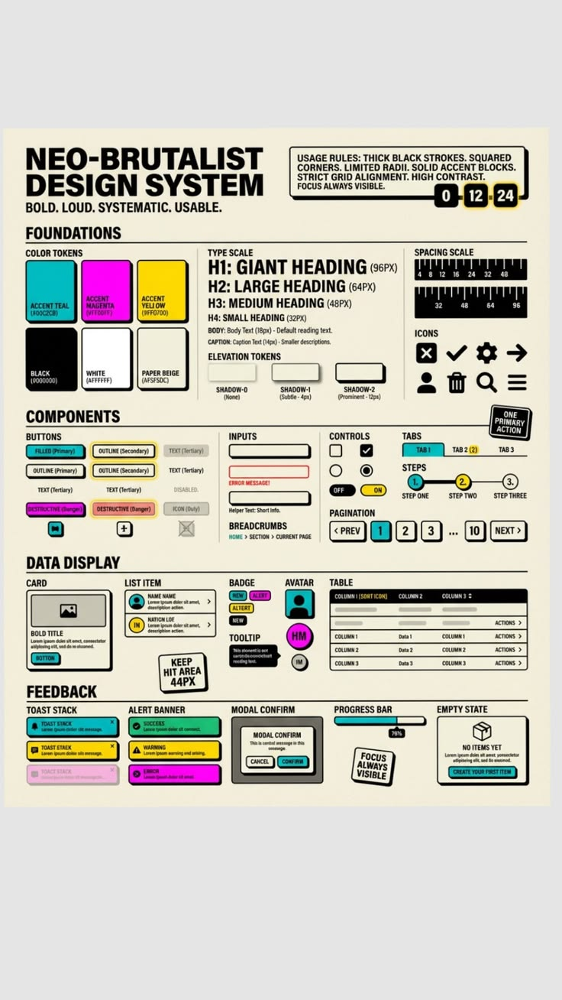
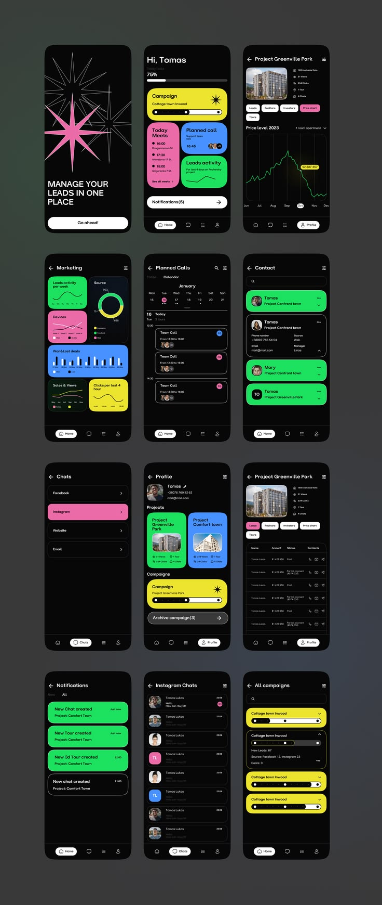
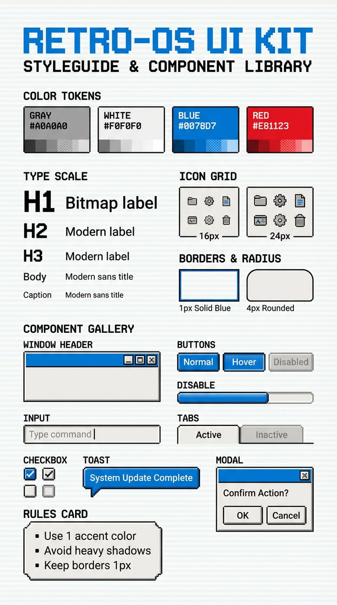
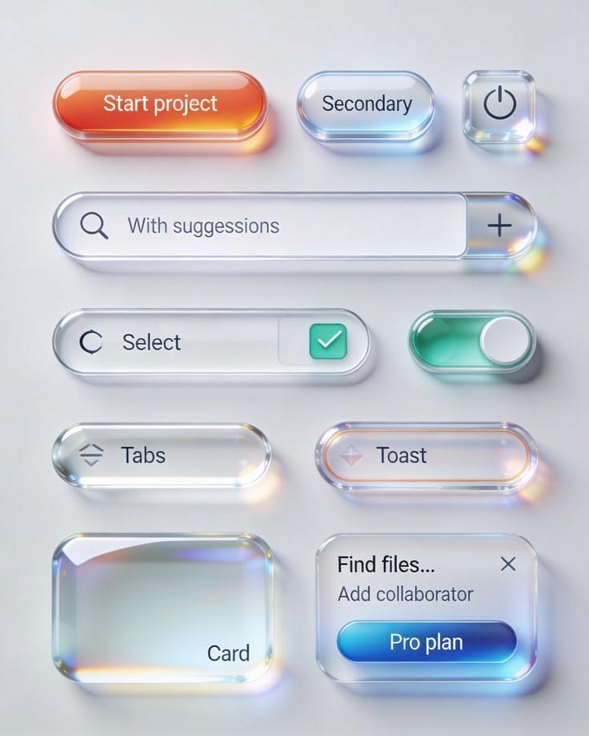

# Design systems, paletas, arquitetura e novo catálogo: especificação

_Revisão de 17/10/2026. Substitui a versão de 14/10/2026: os estilos passam a ser **design systems distintos**, cada um com as suas paletas e os seus componentes, os testes migram para o **Jest** e entra um **padrão de arquitetura** verificado no CI._

Este documento diz **o que** será construído. A ordem de trabalho, os itens e o andamento ficam no [plano de execução dos design systems](plano-de-execucao-design-systems.md).

Esta especificação complementa o [plano de execução do design system](plano-de-execucao.md) e segue o [padrão de pipeline](padrao-de-pipeline.md): branch nova a partir da `main`, testes, lint, `jscpd` e changeset quando mexer em `projects/ui`.

## 1. Objetivo

1. Transformar os estilos do Argila em **design systems (DS) distintos**: cada um tem identidade própria (forma, tipografia, paletas, regras de uso) e **não precisa ter todos os componentes**. O que eles compartilham é só o comportamento e a acessibilidade dos componentes.
2. Cada DS declara as **paletas que aceita**. Paleta deixa de ser um eixo livre que combina com qualquer estilo.
3. Os DS com imagem de referência ficam **o mais próximo possível da imagem** (seção 3.4).
4. Dar aos produtos o conceito de **segmento**: um conjunto nomeado de escolhas (DS, paleta, cores, modo).
5. Fixar um **padrão de arquitetura** (camadas, pastas, regras de dependência) e verificá-lo no CI.
6. Migrar os testes unitários para o **Jest**, com cobertura, relatórios e **monitoramento dos testes** no CI (seção 6).
7. Reorganizar o catálogo com **barra de ícones + painel**, **páginas em abas**, **anatomia**, **templates** e **padrões**.

## 2. Decisões

As decisões de 14/10 continuam valendo, exceto onde a coluna "Revisão" diz o contrário.

| #   | Decisão                                                                                                                                                                                                     | Revisão de 17/10                                                                                                                       |
| --- | ----------------------------------------------------------------------------------------------------------------------------------------------------------------------------------------------------------- | -------------------------------------------------------------------------------------------------------------------------------------- |
| D1  | A paleta `clay` é ajustada para os tons de café (`#26150D`, `#482616`, `#5D3721`, `#896448`, `#AB8D6F`) e passa a se chamar **Terrosa**.                                                                    | Terrosa **deixa de ser a paleta padrão**: vira uma paleta aceita pelo DS Argila. A padrão é a **Massinha** (D18).                      |
| D2  | Estilos: Molde, Argila, Neo-brutalista, Punk, CODA, Transparente e Windows XP.                                                                                                                              | Substituída por **D18**.                                                                                                               |
| D3  | Arcade é removido, sem redirecionamento.                                                                                                                                                                    | —                                                                                                                                      |
| D4  | Argila é 3D "de massinha", opaco. Transparente é vidro fosco, sem neumorfismo.                                                                                                                              | Transparente segue a referência de **vidro espesso** (D24): aro claro, brilho especular e borda iridescente. Continua sem neumorfismo. |
| D5  | Paletas: Terrosa, Preto e branco, Viva, Pastel, Oceano, Floresta, Alto contraste e a nativa de cada estilo.                                                                                                 | Substituída por **D19**.                                                                                                               |
| D6  | Cores de marca (primária, secundária, destaque) de uma **lista fixa já validada**, sem cor livre.                                                                                                           | A lista permitida passa a ser calculada **por DS × paleta**.                                                                           |
| D7  | Cada estilo declara os modos que suporta; nos dois modos, a cor dominante inverte.                                                                                                                          | Declarado no manifesto do DS (5.3).                                                                                                    |
| D8  | Transparência ajustável: padrão 100%, 60% no Transparente, mínimo 40%.                                                                                                                                      | Cada DS diz se aceita o controle (`transparencia: true`). Neo-brutalista, Punk, Windows XP e CODA **não** aceitam.                     |
| D9  | Segmentos declarados pelo app, só com nomes existentes.                                                                                                                                                     | O TypeScript também recusa paleta que o DS não aceita (3.7).                                                                           |
| D10 | Versão minor (`0.2.0` → `0.3.0`), com `data-arg-brand` por compatibilidade.                                                                                                                                 | Feita (#70). As mudanças visuais desta revisão saem na `0.4.0`.                                                                        |
| D11 | Catálogo com todas as seções e navegação por barra de ícones + painel.                                                                                                                                      | O catálogo passa a ser **filtrado pelo DS escolhido** (4.3).                                                                           |
| D12 | Templates são exemplos genéricos com código para copiar.                                                                                                                                                    | —                                                                                                                                      |
| D13 | Padrões em duas levas, com formato fixo.                                                                                                                                                                    | —                                                                                                                                      |
| D14 | Anatomia começa pelos 10 componentes mais usados.                                                                                                                                                           | —                                                                                                                                      |
| D15 | Itens das imagens que o Argila não tem viram variantes do que existe. Chart fica fora.                                                                                                                      | Componentes que só fazem sentido num DS viram **exclusivos desse DS** (3.5). Chart continua fora.                                      |
| D16 | Fontes novas vêm do Google Fonts, carregadas pelo produto.                                                                                                                                                  | —                                                                                                                                      |
| D17 | 6 PRs.                                                                                                                                                                                                      | Substituída por **D22** (13 PRs).                                                                                                      |
| D18 | **Seis design systems**: **Argila** (padrão), **Neo-brutalista**, **Punk**, **Transparente**, **Windows XP** e **CODA**. **Molde** fica como base interna para criar DS novos (não aparece para o produto). | **Nova**; CODA incluído em 17/10 (E-D3)                                                                                                |
| D19 | **Paletas por DS**: cada DS tem uma paleta nativa (a da imagem de referência) e uma lista curta de paletas aceitas (3.6). Combinação fora da lista não existe.                                              | **Nova**                                                                                                                               |
| D20 | **Componentes por DS**: cada componente tem, em cada DS, o status **curado**, **herdado** ou **fora**; e cada DS pode ter **componentes exclusivos** (3.5).                                                 | **Nova**                                                                                                                               |
| D21 | **Jest** substitui o Vitest em todo o repositório (ui, docs e scripts), com cobertura mínima de 80%, relatório JUnit e resumo dos testes em todo PR (seção 6).                                              | **Nova**                                                                                                                               |
| D22 | **13 PRs** ([plano de execução](plano-de-execucao-design-systems.md)): checkup, Jest e arquitetura antes dos visuais; um PR por DS.                                                                         | **Nova**                                                                                                                               |
| D23 | Respostas de 17/10: E-D1 (Massinha padrão), E-D2 (Windows XP com as cores da referência), E-D5 (`0.4.0`) e E-D6 (imagens versionadas só para consulta) seguem a opção padrão.                               | **Nova**                                                                                                                               |
| D24 | O Transparente ganha referência (E-D4): fica **o mais próximo possível** da imagem, sabendo que vidro com refração real não existe em CSS (3.4).                                                            | **Nova**                                                                                                                               |

## 3. Os design systems

### 3.1 O que é compartilhado e o que é de cada DS

| Compartilhado por todos (núcleo)                                      | De cada DS                                                                   |
| --------------------------------------------------------------------- | ---------------------------------------------------------------------------- |
| Comportamento dos componentes (estado, eventos, formulários, teclado) | Forma: raio, borda, sombra/relevo, espaçamento, densidade                    |
| Acessibilidade (ARIA, foco, contraste mínimo AA)                      | Tipografia: famílias, escala, caixa alta, peso                               |
| Nomes dos tokens semânticos (`--arg-color-primary`, `--arg-radius-…`) | Valores dos tokens, paleta nativa e paletas aceitas                          |
| `ArgTheme`, segmentos, lista fixa de cores                            | Pele dos componentes curados, componentes exclusivos, ornamentos             |
| Teste de contraste, testes de arquitetura                             | Regras de uso ("faça e não faça"), modos suportados, se aceita transparência |

Um DS **nunca** importa nada de outro DS. Se dois DS precisam da mesma coisa, ela sobe para o núcleo.

### 3.2 Os eixos

| Eixo           | No `<html>`                                   | API (`ArgTheme`)                     | Controla                                                   |
| -------------- | --------------------------------------------- | ------------------------------------ | ---------------------------------------------------------- |
| Design system  | `data-arg-style`                              | `setStyle('neo-brutalista')`         | tudo o que é "de cada DS" na tabela 3.1                    |
| Paleta         | `data-arg-palette`                            | `setPalette('nativa')`               | cores, **só entre as paletas aceitas pelo DS**             |
| Cores de marca | `data-arg-primary` / `-secondary` / `-accent` | `setColors({ primary: 'cobre', … })` | sobrescrevem as cores-base, só com cores permitidas no par |
| Modo           | `data-arg-theme`                              | `setColorScheme('dark')`             | claro / escuro / automático, limitado aos modos do DS      |
| Transparência  | `--arg-surface-opacity`                       | `setSurfaceOpacity(0.6)`             | opacidade das superfícies, de 0,4 a 1, só se o DS aceitar  |
| Segmento       | `data-arg-segment`                            | `setSegment('premium')`              | aplica de uma vez todos os eixos acima                     |

Ao trocar de DS, o `ArgTheme` confere a paleta, as cores, o modo e a transparência atuais. O que o DS novo não aceita volta para o padrão dele, e o `ArgTheme` emite um aviso em modo de desenvolvimento.

Precedência, da mais fraca para a mais forte: **padrão do DS → paleta escolhida → cores de marca → segmento**.

### 3.3 Modos e inversão da cor dominante

Quando o DS aceita os dois modos, a **cor dominante** (fundo e superfícies) troca de lado e a cor de ação vai para o lado oposto. Exemplo na paleta Terrosa do DS Argila:

| Papel                | Claro: **bege domina** | Escuro: **marrom domina**      |
| -------------------- | ---------------------- | ------------------------------ |
| Fundo                | `#F4EDE4`              | `#26150D`                      |
| Superfície           | `#FBF7F2`              | `#33200F`                      |
| Superfície elevada   | `#FFFFFF`              | `#482616`                      |
| Superfície rebaixada | `#E6D9C7`              | `#1C0F09`                      |
| Texto                | `#26150D`              | `#F4EDE4`                      |
| Texto secundário     | `#5D3721`              | `#AB8D6F`                      |
| Primária (ação)      | `#5D3721`              | `#AB8D6F`, com texto `#26150D` |
| Secundária           | `#896448`              | `#C7AE94`                      |
| Destaque             | `#482616`              | `#D9C2A6`                      |
| Bordas               | `#D9C9B4` / `#AB8D6F`  | `#5D3721` / `#896448`          |

Os valores finais saem do teste de contraste: se algum par ficar abaixo de AA, o valor é ajustado no PR, sem mudar o papel da cor.

### 3.4 Ficha de cada DS

Regra geral: **o DS fica o mais próximo possível da sua imagem de referência**, identificada pelo título que aparece nela. As imagens ficam em [`docs/referencias/`](referencias/README.md), só para consulta do time (seção 9). Os hexadecimais abaixo foram lidos das imagens e são o ponto de partida; o teste de contraste pode ajustá-los.

#### Argila (padrão) — referência: "Product UI Styleguide"



| Item                       | Definição                                                                                                                                                                                                                                            |
| -------------------------- | ---------------------------------------------------------------------------------------------------------------------------------------------------------------------------------------------------------------------------------------------------- |
| Linguagem                  | 3D macio "de massinha": superfícies quase brancas, volume com sombra difusa embaixo e realce interno em cima, nada de contorno escuro                                                                                                                |
| Forma                      | controles em pílula; cards e contêineres com raio de 20px; campos **rebaixados** em pílula (sombra interna) com ícone à direita; foco como **anel menta com brilho**                                                                                 |
| Elevação                   | 5 níveis (Level 1–5), mostrados como cartões empilhados; cada nível aumenta deslocamento e desfoque da sombra                                                                                                                                        |
| Tipografia                 | sans do sistema; escala Display / H1 / H2 / H3 / Body / Caption                                                                                                                                                                                      |
| Paleta nativa **Massinha** | primária menta `#9FE3C7`, superfície `#FFFFFE`, fundo `#F2F2EF`, borda `#E5E5E0`, anel de foco `#7FE0C0`; feedback: sucesso menta, aviso amarelo `#F3E08A`, erro rosa `#F09A9A`                                                                      |
| Componentes da referência  | botões padrão/hover/desabilitado (hover com brilho), busca em pílula, chips (filtro, selecionado com ✓, desabilitado), abas **segmentadas** (trilho em pílula) e abas **sublinhadas**, alertas em pílula com ícone, card com imagem e pílula de ação |
| Modos                      | claro e escuro (no escuro, o volume usa brilho em vez de sombra)                                                                                                                                                                                     |
| Transparência              | aceita                                                                                                                                                                                                                                               |

#### Neo-brutalista — referência: "Neo-Brutalist Design System"



| Item                        | Definição                                                                                                                                                                                                                                                                                                                                                                     |
| --------------------------- | ----------------------------------------------------------------------------------------------------------------------------------------------------------------------------------------------------------------------------------------------------------------------------------------------------------------------------------------------------------------------------- |
| Linguagem                   | "Bold. Loud. Systematic. Usable.": traço preto grosso, cantos retos, blocos de cor chapada, grade rígida, alto contraste                                                                                                                                                                                                                                                      |
| Forma                       | contorno preto de 3px em tudo; raio máximo de 4px; sombra **dura** deslocada (`shadow-0` nenhuma, `shadow-1` 4px, `shadow-2` 12px, sempre `x y 0 #000`); alvo mínimo de **44px**; foco sempre visível com moldura grossa amarela                                                                                                                                              |
| Espaçamento                 | escala 4 · 8 · 12 · 16 · 24 · 32 · 48 · 64 · 96                                                                                                                                                                                                                                                                                                                               |
| Tipografia                  | títulos em caixa alta, Archivo Black; corpo Archivo. Escala: H1 96px, H2 64px, H3 48px, H4 32px, Body 18px, Caption 14px                                                                                                                                                                                                                                                      |
| Paleta nativa **Papel CMY** | papel bege `#F5F5DC`, preto `#000000`, branco `#FFFFFF`, ciano `#00C2CB`, magenta `#FF00FF`, amarelo `#FFD700`                                                                                                                                                                                                                                                                |
| Componentes da referência   | botões filled / outline / text / destructive / disabled / icon; input com erro e texto de ajuda; checkbox, radio, toggle OFF/ON; abas com contador; steps; paginação com "PREV/NEXT"; breadcrumb; card; list item com avatar; badge; avatar; tooltip escuro; tabela com ordenação; pilha de toasts; alert banner; modal de confirmação; barra de progresso com %; empty state |
| Regras de uso               | um único botão primário por tela; foco sempre visível; alvo de 44px; texto sobre bloco colorido sempre preto                                                                                                                                                                                                                                                                  |
| Modos                       | claro (nativo) e escuro (papel grafite, contorno off-white). Se o escuro perder a identidade, fica **só claro**                                                                                                                                                                                                                                                               |
| Transparência               | não aceita                                                                                                                                                                                                                                                                                                                                                                    |

#### Punk — referência: app escuro de gestão de leads com cards neon



| Item                      | Definição                                                                                                                                                                                                                                                                                                                        |
| ------------------------- | -------------------------------------------------------------------------------------------------------------------------------------------------------------------------------------------------------------------------------------------------------------------------------------------------------------------------------- |
| Linguagem                 | fundo preto absoluto, **cards de cor chapada** em néon, títulos pesados, ornamento de estrela "explosão"                                                                                                                                                                                                                         |
| Forma                     | cards com raio de 24px; botões em **pílula branca** com texto preto; listas com contorno cinza-escuro `#2A2A2A` e chevron; barra de navegação inferior com o item ativo em pílula branca                                                                                                                                         |
| Tipografia                | títulos em Unbounded (caixa alta na tela de entrada), corpo sans do sistema                                                                                                                                                                                                                                                      |
| Paleta nativa **Néon**    | preto `#000000`, superfície `#111111`, rosa `#F06BB8`, amarelo `#EDF040`, verde `#3FE36B`, azul `#4C8DFF`, branco `#FFFFFF`                                                                                                                                                                                                      |
| Componentes da referência | card chapado de indicador; trilha de progresso com pontos e alça; calendário em faixa com o dia escolhido em rosa; chips em contorno com o selecionado em rosa; lista de conversas com avatar e contador; cards de notificação verdes; acordeão de contato; tabela compacta; barra de navegação inferior; busca em pílula escura |
| Regras de uso             | texto sobre card sempre preto (as quatro cores são claras); no máximo 3 cores de card por tela; a estrela só como ornamento, nunca como ícone de ação                                                                                                                                                                            |
| Modos                     | **só escuro** é o nativo. Claro (papel off-white, cards chapados com contorno preto) entra só se passar no teste visual; senão fica só escuro                                                                                                                                                                                    |
| Transparência             | não aceita                                                                                                                                                                                                                                                                                                                       |

Gráficos das telas de referência (linhas, rosca, barras) continuam fora (D15): os cards de indicador mostram número e rótulo.

#### Windows XP — referência: "Retro-OS UI Kit"



| Item                      | Definição                                                                                                                                                                                                                                                               |
| ------------------------- | ----------------------------------------------------------------------------------------------------------------------------------------------------------------------------------------------------------------------------------------------------------------------- |
| Linguagem                 | sistema operacional retrô: janelas com barra de título azul, bordas de 1px, fundo com listras horizontais finas (linhas de varredura), ícones em pixel                                                                                                                  |
| Forma                     | bordas de **1px** (azul sólido no foco, cinza no resto); raio **0 ou 4px** (os dois que a referência mostra); botões com bisel de 1px; sem sombra pesada                                                                                                                |
| Tipografia                | títulos em fonte bitmap (**Pixelify Sans**, Google Fonts), corpo e rótulos em sans moderna (Tahoma / sistema). Escala H1 / H2 / H3 / Body / Caption                                                                                                                     |
| Ícones                    | grade de 16px e 24px, desenhados em pixel (variação do conjunto de ícones, não ícones novos)                                                                                                                                                                            |
| Paleta nativa **Retro**   | cinza `#A0A0A0`, branco `#F0F0F0`, azul `#0078D7`, vermelho `#E81123`, cada uma com rampa de 5 tons                                                                                                                                                                     |
| Componentes da referência | barra de título de janela (minimizar, maximizar, fechar); botões normal/hover/desabilitado; barra de progresso; campo "de comando" com cursor; abas em pasta ativa/inativa; checkbox azul e cinza; toast em **balão**; modal de confirmação OK/Cancelar; card de regras |
| Regras de uso             | uma só cor de destaque (azul); nada de sombra pesada; bordas sempre de 1px                                                                                                                                                                                              |
| Modos                     | claro e escuro                                                                                                                                                                                                                                                          |
| Transparência             | não aceita                                                                                                                                                                                                                                                              |

A mudança da paleta nativa (do cinza com azul-marinho atual para a Retro) entra no changelog da `0.4.0`.

#### Transparente — referência: botões e cards de vidro espesso



| Item                      | Definição                                                                                                                                                                                                                                                                                                                                                                  |
| ------------------------- | -------------------------------------------------------------------------------------------------------------------------------------------------------------------------------------------------------------------------------------------------------------------------------------------------------------------------------------------------------------------------- |
| Linguagem                 | **vidro espesso e polido** sobre fundo cinza-claro: peças translúcidas com aro claro e grosso, brilho especular no topo, borda iridescente (arco-íris discreto nas quinas) e sombra colorida projetada, como luz atravessando o vidro. Sem neumorfismo                                                                                                                     |
| Forma                     | controles em **pílula** com altura generosa (56px no tamanho padrão); botão de ícone **quadrado** com raio de 16px; cards e painéis com raio de 24px; aro claro de 3px por dentro e linha escura de 1px por fora; botões coloridos em **gradiente** com faixa de brilho no topo                                                                                            |
| Profundidade              | três camadas por peça: (1) superfície translúcida com `backdrop-filter: blur()`; (2) aro e brilho com `box-shadow` interno (`inset 0 1px 0` branco forte em cima, `inset 0 -8px 16px` branco suave embaixo, `inset 0 0 0 3px` branco a 25%); (3) borda iridescente num `::before` com `conic-gradient` (rosa, âmbar, ciano, azul) recortado por `mask`, a 40% de opacidade |
| Sombra                    | difusa e neutra (`0 12px 24px` a 12%) mais um **reflexo colorido** deslocado, na cor da peça (laranja no primário, verde-água no switch, azul no destaque)                                                                                                                                                                                                                 |
| Tipografia                | sans do sistema, peso regular, texto cinza-grafite; nada em caixa alta                                                                                                                                                                                                                                                                                                     |
| Paleta nativa **Vidro**   | fundo `#ECEEF1`; vidro branco a 55%; texto `#2B2F36`; primária laranja em gradiente `#E8502A` → `#F7A15A`; destaque azul em gradiente `#1F6FE5` → `#5AB0F7`; marcado e ligado em verde-água `#2FB58A`; aro do toast em laranja `#F2A36B`                                                                                                                                   |
| Componentes da referência | botão primário laranja, secundário de vidro e botão de ícone quadrado; busca "com sugestões" com botão **+ acoplado** ao campo; select com marcador verde-água; switch verde-água com pino branco; abas em pílula com ícone; toast em pílula com aro laranja; card de vidro grosso; popover com título, subtítulo, fechar e botão azul                                     |
| Regras de uso             | vidro sempre sobre fundo com algum conteúdo ou textura (vidro sobre branco liso some); no máximo **um** botão colorido por grupo; texto nunca diretamente sobre a borda iridescente                                                                                                                                                                                        |
| Modos                     | claro (nativo). Escuro como **vidro fumê** (fundo `#14161A`, vidro branco a 10%, aro a 15%); se perder a identidade, fica **só claro**                                                                                                                                                                                                                                     |
| Transparência             | aceita; padrão 60%. Abaixo de 50%, os painéis sobre o conteúdo (Dialog, Popover, Menu, Toast) ficam presos em 80%, para o texto de trás não aparecer                                                                                                                                                                                                                       |

**Até onde o CSS chega.** A imagem é uma renderização 3D. O objetivo é chegar o mais perto possível, sabendo que:

- a **refração** (o fundo entortando através do vidro) fica fora: só funciona com filtro SVG de deslocamento dentro do `backdrop-filter`, que hoje só o Chromium aceita. Pode entrar depois como melhoria opcional, sem ser exigida no teste visual;
- a **iridescência** é imitada com um gradiente cônico fixo e não muda com o ângulo de visão;
- com `prefers-reduced-transparency` ou `forced-colors`, as peças viram superfícies opacas com borda simples, sem perder contraste;
- sem suporte a `backdrop-filter`, o vidro cai para branco a 85%.

#### CODA — sem imagem de referência

| Item                   | Definição                                                                                                                                               |
| ---------------------- | ------------------------------------------------------------------------------------------------------------------------------------------------------- |
| Linguagem              | identidade da Semana da Computação e Dados da UFABC: **pixel** em tudo, contornos marcados, rosa e amarelo sobre grafite                                |
| Forma                  | contorno de 2px nos controles; raio pequeno (`radius-2` nos controles, `radius-3` nos contêineres); sem sombra difusa                                   |
| Tipografia             | **Silkscreen** em todo o texto, um degrau menor em cada tamanho (a fonte é larga). Diferença para o Windows XP: lá a fonte em pixel fica só nos títulos |
| Paleta nativa **CODA** | grafite `#1C1C1C`; rosa `#F27AAE` (escuro) / `#B0205F` (claro); amarelo `#F5EC3A` (escuro) / `#6B5E00` (claro); fundo claro `#FFF5FA`                   |
| Regras de uso          | amarelo só para foco e destaque; rosa para ação; texto longo de leitura pode usar a mono do sistema em vez da Silkscreen                                |
| Modos                  | claro e escuro (o escuro é o da identidade)                                                                                                             |
| Transparência          | não aceita                                                                                                                                              |

A ficha parte do visual atual do CODA. Quando houver imagem de referência, ela entra como `docs/referencias/coda.jpg` e a ficha é refeita no mesmo formato.

### 3.5 Componentes por DS

Cada componente do núcleo tem um status em cada DS, declarado no manifesto do DS (5.3):

| Status      | O que significa                                                                                      | No catálogo                                       |
| ----------- | ---------------------------------------------------------------------------------------------------- | ------------------------------------------------- |
| **Curado**  | tem pele própria no DS, passa no teste visual e no de contraste                                      | aparece normalmente                               |
| **Herdado** | funciona só pelos tokens do DS, sem pele própria; acessível, mas sem garantia de fidelidade à imagem | aparece com o aviso "sem curadoria neste DS"      |
| **Fora**    | não faz parte do DS                                                                                  | não aparece; em desenvolvimento, aviso no console |

**Núcleo mínimo:** todo DS tem como **curados** Button, Icon Button, Input, Field, Select, Choice, Tabs, Card, Dialog, Alert, Toast, Progress Bar, Badge, Tag, Tooltip, Empty State, Spinner, Link e Divider. Os demais começam como herdados e sobem para curados quando entram na referência do DS.

**Componentes exclusivos** (só existem no DS indicado e ficam na pasta dele):

| DS             | Exclusivos                                                                                                                                |
| -------------- | ----------------------------------------------------------------------------------------------------------------------------------------- |
| Argila         | nenhum: os itens da referência viram variantes (abas segmentadas, chips, card empilhado)                                                  |
| Neo-brutalista | `arg-nb-sticker` (selo inclinado, como "ONE PRIMARY ACTION"), `arg-nb-rules` (caixa de regras de uso)                                     |
| Punk           | `arg-punk-stat-card` (card chapado de indicador), `arg-punk-dot-track` (trilha de pontos com alça), `arg-punk-burst` (estrela ornamental) |
| Windows XP     | `arg-xp-window` (janela com barra de título e botões), `arg-xp-balloon` (toast em balão)                                                  |
| Transparente   | nenhum: o botão **+ acoplado** à busca vira variante do Input (4.7)                                                                       |
| CODA           | nenhum                                                                                                                                    |

O prefixo do DS no seletor (`arg-nb-`, `arg-punk-`, `arg-xp-`) deixa claro, no código do produto, que aquele componente prende o produto ao DS.

Matriz inicial (C = curado, H = herdado, — = fora; os do núcleo mínimo são C em todos):

| Componente  | Argila | Neo-brutalista | Punk | Windows XP | Transparente | CODA |
| ----------- | ------ | -------------- | ---- | ---------- | ------------ | ---- |
| Agenda      | H      | H              | C    | —          | H            | H    |
| Avatar      | H      | C              | C    | H          | H            | H    |
| Breadcrumb  | H      | C              | —    | H          | H            | H    |
| Combobox    | H      | H              | H    | H          | C            | H    |
| Date Picker | H      | H              | C    | H          | H            | H    |
| Drawer      | H      | H              | C    | —          | C            | H    |
| List        | H      | C              | C    | H          | H            | H    |
| Menu        | H      | H              | H    | C          | C            | H    |
| Pagination  | H      | C              | —    | H          | H            | H    |
| Popover     | H      | H              | H    | H          | C            | H    |
| Stepper     | H      | C              | H    | H          | H            | H    |
| Table       | H      | C              | C    | H          | H            | H    |
| Time Slots  | H      | H              | C    | —          | H            | H    |

Os componentes que não aparecem na matriz são **herdados** em todos os DS. A matriz é revista em cada PR que curar um componente.

### 3.6 Paletas por DS (D19)

| DS             | Nativa (padrão) | Também aceita                                             |
| -------------- | --------------- | --------------------------------------------------------- |
| Argila         | **Massinha**    | Terrosa, Oceano, Floresta, Preto e branco, Alto contraste |
| Neo-brutalista | **Papel CMY**   | Pastel, Preto e branco, Alto contraste                    |
| Punk           | **Néon**        | Viva, Alto contraste                                      |
| Windows XP     | **Retro**       | Alto contraste                                            |
| Transparente   | **Vidro**       | Oceano, Terrosa, Preto e branco                           |
| CODA           | **CODA**        | Viva, Preto e branco, Alto contraste                      |

- As paletas compartilhadas (Terrosa, Oceano, Floresta, Pastel, Viva, Preto e branco, Alto contraste) moram em `tokens/palettes/`. O DS pode **ajustar** uma paleta compartilhada no arquivo dele (`design-systems/<ds>/paletas/<paleta>.css`), sem copiar a paleta inteira.
- **Para criar uma paleta compartilhada:** o CSS em `tokens/palettes/<id>.css`, uma entrada em `src/lib/design-systems/palettes.ts` (nome e se tem arquivo) e o id na lista `paletas` de cada manifesto que a aceitar. O teste de contraste, o checkup, os tipos (`ArgPalette`) e a barra de tema do catálogo passam a cobri-la sozinhos; um id que não está no registro não compila.
- A **paleta padrão do Argila passa a ser a Massinha**, da imagem de referência. Ela é o próprio padrão dos tokens semânticos (vale sem `temas.css`); a Terrosa virou `tokens/palettes/terrosa.css`. Quem quiser o visual café escreve `data-arg-palette="terrosa"`.
- **Preenchimento suave da marca:** toda cor de marca também serve de texto, então precisa de 4,5:1 sobre branco, e um pastel como o menta da referência nunca passaria. O token `--arg-color-primary-soft` (com `--arg-color-on-primary-soft`) é o preenchimento de botões, chips e alertas suaves; toda paleta o define, e o par entra no teste de contraste.
- A **Alto contraste** é testada em AAA (7:1) para texto, texto secundário e link sobre fundos e superfícies.
- O teste de contraste roda **só nas combinações aceitas** (cerca de 26 pares DS × paleta, em vez de 56).

### 3.7 Cores de marca (D6)

A lista fixa tem 16 cores (cobre, caramelo, terracota, oliva, musgo, petróleo, ardósia, anil, ameixa, vinho, coral, mostarda, grafite, areia, menta e lavanda), registradas em `src/lib/design-systems/colors.ts` (`ARG_BRAND_COLORS`) com valor claro e escuro e o texto por cima de cada um. `hover`, `pressed` e `subtle` continuam derivados nos tokens semânticos; na primária, o preenchimento suave acompanha a cor.

- **Fonte única e gerador.** `pnpm colors` (`scripts/gerar-cores.ts`) gera, a partir do registro, o `tokens/colors.css` e o `colors.generated.ts` (`ARG_ALLOWED_COLORS`): para cada DS × paleta aceita × papel, as cores com as quais **todos os pares do teste de contraste passam**, em cada modo do DS e com as superfícies a 40% (AAA no texto da Alto contraste). `pnpm colors:check` roda no CI e falha se algo estiver desatualizado; o teste de contraste confere de novo cada cor permitida.
- **Precedência.** O seletor `:root[data-arg-primary][data-arg-primary='cobre']` tem a força das paletas nativas (0,3,0), e o `colors.css` vem por último no `temas.css`: a cor de marca vence a paleta.
- **No Angular**, `setColors({ primary, secondary, accent })` só aplica as cores permitidas no par atual (`allowedColors()`), avisa das outras em desenvolvimento e revalida ao trocar de DS ou paleta. Sem Angular, os atributos `data-arg-primary`, `-secondary` e `-accent`.
- `setBrand({ primary: '#hex' })` continua por compatibilidade, com o aviso de que o contraste vira responsabilidade do produto.

### 3.8 Segmentos (D9)

O app declara os segmentos uma vez, com `provideArgila`. O tipo `ArgSegment` é uma união por design system: o TypeScript recusa paleta que o DS não aceita. As cores são da lista fixa; uma cor que não passa no par é ignorada pelo `ArgTheme`, com aviso.

```ts
provideArgila({
  segments: {
    essencial: { style: 'argila' }, // paleta padrão: Massinha
    premium: {
      style: 'argila',
      palette: 'terrosa',
      scheme: 'dark',
      colors: { accent: 'caramelo' },
    },
    vibrante: { style: 'coda', palette: 'viva', colors: { primary: 'coral' } },
    // erro de tipo: o Windows XP não aceita a Terrosa
    // errado: { style: 'windows-xp', palette: 'terrosa' },
  },
  defaultSegment: 'essencial',
});

inject(ArgTheme).setSegment('premium');
```

`setSegment` aplica de uma vez o design system, a paleta (ou a padrão dele), as cores, o modo e a transparência, e marca `data-arg-segment` no `<html>`. Quando o segmento fixa o modo (`scheme: 'dark'`), o seletor de modo do produto pode ficar escondido.

**Sem Angular**, um segmento é só um conjunto de atributos no `<html>`: `argSegmentAttributes(segmento)` os devolve (para HTML estático ou renderização no servidor). O gerador de CSS por segmento (`pnpm argila:segmentos`) previsto antes não foi feito: ele copiaria os tokens de cada combinação num seletor novo, sem ganho sobre os atributos.

### 3.9 Transparência (D8)

- Só nos DS com `transparencia: true` no manifesto (Argila e Transparente). Nos outros, o controle fica desabilitado com o motivo.
- `--arg-surface-opacity` vai de 0,4 a 1, presa pelo `ArgTheme` e por `clamp()` no CSS.
- As superfícies usam `color-mix(in oklab, var(--arg-color-surface) calc(var(--arg-surface-opacity) * 100%), transparent)`, e `--arg-surface-blur` vai de 0 a 16px conforme a opacidade cai.
- O teste de contraste usa o **pior caso** (40% sobre o fundo da paleta).

## 4. Catálogo

### 4.1 Navegação

**Barra de ícones fixa à esquerda**, com o rótulo embaixo de cada ícone. Ao clicar, abre um **painel** com os itens da seção, que fica aberto até a pessoa escolher uma página ou clicar fora. A busca fica no topo do painel. No celular, barra e painel ficam numa gaveta.

Ícones novos (`book`, `rocket`, `layers`, `layout`, `wrench`, `help-circle`, `accessibility`, `sparkles`) seguem a seção 1.2 do [design system próprio](design-system-proprio.md).

| Seção          | Começa com                                                                                                                           |
| -------------- | ------------------------------------------------------------------------------------------------------------------------------------ |
| Início         | a página atual                                                                                                                       |
| Atualizações   | _(enxuta)_ o `CHANGELOG.md` do pacote                                                                                                |
| Como começar   | instalar, importar tokens, escolher DS/paleta/segmento, primeiro componente                                                          |
| Acessibilidade | princípios, contraste, teclado, leitor de tela, como o Argila testa                                                                  |
| Design systems | **nova**: uma página por DS com a ficha da 3.4 (linguagem, tokens, tipografia, paletas aceitas, regras de uso, componentes e status) |
| Fundação       | Tokens, Ícones, Cores, Tipografia, Espaçamento, Raio e elevação, Movimento                                                           |
| Componentes    | componentes do núcleo em famílias, mais os **exclusivos do DS escolhido**                                                            |
| Padrões        | leva 1 (4.5)                                                                                                                         |
| Templates      | Sobre templates, Empty State, Ending Screen, Error Message, Loaders, Receipt                                                         |
| Ferramentas    | _(enxuta)_ **Montar tema**: escolher DS, paleta, cores, modo e transparência e copiar o segmento ou o CSS                            |
| Ajuda          | _(enxuta)_ perguntas frequentes, como pedir um componente, como contribuir                                                           |

### 4.2 Barra de tema no cabeçalho

**Design system** (select) · **Paleta** (só as aceitas pelo DS) · **Cores** (só as permitidas no par) · **Transparência** (desabilitada quando o DS não aceita) · **Modo** (desabilitado quando o DS só tem um) · **Segmento de exemplo** (Essencial, Premium, Vibrante).

Tudo fica salvo no navegador e na URL. Um link com combinação inválida cai no padrão do DS e mostra um aviso.

### 4.3 Catálogo filtrado pelo DS

- Componentes **fora** do DS escolhido somem da navegação; quem abre a URL direto vê "Este componente não faz parte do DS X", com link para os DS que o têm.
- Componentes **herdados** mostram o aviso "sem curadoria neste DS".
- Cada página de componente tem a linha "Disponível em": os seis DS com o status de cada um.

### 4.4 Página em abas

- **Cabeçalho** com título, resumo e "Atualizado em dd/mm/aaaa às hh:mm" (último commit do `*.docs.ts`, gerado pelo manifesto).
- **Abas** com a aba ativa na URL (`/componentes/button/codigo`): **Visão geral**, **Regras de uso** (as gerais e as do DS escolhido), **Código**, **Acessibilidade**.
- **Índice "nesta página"** à direita nas telas largas.

Campos novos no `DocPage`, todos opcionais:

```ts
category: 'Fundação' | 'Componentes' | 'Padrões' | 'Templates' | 'Design systems';
group?: string;
designSystem?: DesignSystemId; // só nos exclusivos
whenToUse?: string[];
whenNotToUse?: string[];
anatomy?: { example: Type<unknown>; parts: { label: string; description: string }[] };
keyboard?: { key: string; action: string }[];
related?: string[];
pattern?: { problem: string; solution: string };
```

**Anatomia:** o exemplo marca cada parte com `data-anatomy="1"`, e o catálogo desenha marcadores numerados na cor de destaque. Primeiros 10: Button, Input, Select, Card, Dialog, Alert, Toast, Tabs, Table e Empty State.

### 4.5 Padrões

Formato fixo: **Problema → Solução → Exemplo com componentes reais → Variações → Faça / não faça → Componentes usados**.

- **Leva 1:** Sobre padrões, Carregamentos, Erros e feedback, Data entry, Mostrar e ocultar, Navegação, Layout, Aplicação de cores.
- **Leva 2:** Senhas, Comprovantes, Linhas do tempo, Contextos, Encontrabilidade de ajuda, Espaços de vitrine, Home, Menu de hubs, Indicadores de experiência, Princípios aplicados à IA.

Padrões e templates usam só componentes do **núcleo mínimo**, para funcionar em todos os DS.

### 4.6 Templates

| Template      | Conteúdo                                                               |
| ------------- | ---------------------------------------------------------------------- |
| Empty State   | lista vazia, busca sem resultado, primeiro uso                         |
| Ending Screen | sucesso no fim de um fluxo, com próximos passos                        |
| Error Message | erro de carregamento, sem conexão, sem permissão, com "tentar de novo" |
| Loaders       | carregamento de tela cheia, de seção e de ação                         |
| Receipt       | comprovante com resumo, detalhes, compartilhar e baixar                |

### 4.7 Variantes nos componentes do núcleo (D15)

| Item                     | Onde entra                                                                                  |
| ------------------------ | ------------------------------------------------------------------------------------------- |
| Pagination Dots          | `arg-pagination` com `variant="dots"`                                                       |
| Progress Steps / Tracker | `arg-stepper` com `orientation="vertical"`                                                  |
| Busca com ação acoplada  | `arg-input` com botão no fim (`argInputAction`), como o **+** da referência do Transparente |
| Bottom Sheet             | `arg-drawer` com `position="bottom"`                                                        |
| Abas segmentadas         | `arg-tabs` com `variant="segmented"` (referência Argila)                                    |
| Chips                    | `arg-tag` com `selectable` (referências Argila e Punk)                                      |
| Linha do tempo           | padrão "Linhas do tempo", montado com List                                                  |
| Shortcut                 | padrão montado com Card + Icon Button                                                       |

## 5. Padrão de arquitetura

### 5.1 Camadas

```
1. tokens/primitives.css          rampas de cor e escalas cruas, sem significado
        ↓
2. tokens/semantic.css            nomes semânticos com valor padrão (o contrato)
        ↓
3. design systems                 manifesto, forma, paletas, peles e exclusivos de cada DS
        ↓
4. src/lib/<componente>/          núcleo: comportamento + a11y, estilizado só por tokens semânticos
        ↓
5. src/lib/theme/                 ArgTheme, segmentos, leitura dos manifestos
        ↓
6. projects/docs/                 catálogo (consome o pacote como um produto consumiria)
```

Uma camada só depende das que estão **acima** dela. A exceção são os **exclusivos** de um DS (camada 3), que podem usar componentes do núcleo (camada 4).

### 5.2 Pastas

O DS padrão (Argila) usa a raiz `:root:is([data-arg-style='argila'], :not([data-arg-style], [data-arg-brand]))`: vale com o atributo e sem estilo nenhum, mas não nos temas antigos. O `index.css` dele vem no `argila.css`, então o visual padrão não depende do `temas.css`. As peles miram a classe estável do componente (`.arg-button`, `.arg-card`…), que vale também quando ele é criado sem o atributo do seletor (`createComponent`), e não redefinem tokens que as variantes usam.

Cada DS se divide em duas pastas com o mesmo nome: o **CSS** fica em `tokens/` (o empacotamento copia os `.css` dali para o pacote) e o **TypeScript** fica em `src/lib/` (o compilador só enxerga `src/`).

```
projects/ui/
  tokens/
    primitives.css  semantic.css  base.css  colors.css  temas.css
    palettes/                       paletas compartilhadas (oceano, floresta, pastel, viva, mono, alto-contraste)
    design-systems/<ds>/            o CSS de cada DS (o Argila, padrão, não tem: os tokens semânticos são dele)
      forma.css                     raio, borda, sombra, espaçamento, tipografia
      paletas/
        nativa.css                  a paleta da imagem de referência
        <paleta>.css                ajustes opcionais numa paleta compartilhada
      componentes/
        button.css  input.css …     pele dos componentes curados, um arquivo por curado
      index.css                     junta forma, paletas e peles; o temas.css importa os índices
    styles/  palettes/nativas/      caminhos antigos, só reencaminham (removidos numa major)
    themes/                         só compatibilidade com data-arg-brand
  src/
    lib/design-systems/
      design-system.ts              tipo do manifesto, ARG_COMPONENTS e o núcleo mínimo
      palettes.ts                   registro das paletas compartilhadas (nome, se tem arquivo)
      design-systems.ts             ARG_DESIGN_SYSTEMS e os tipos ArgStyle, ArgPalette, ArgPaletteOf
      <ds>/
        ds.ts                       manifesto (5.3)
        exclusivos/<prefixo>-<nome>/  mesma estrutura de um componente do núcleo
    lib/<componente>/               núcleo, como hoje: <c>.ts, <c>.html, <c>.css, <c>.spec.ts, <c>.docs.ts, examples/
    lib/theme/
    testing/                        a11y, contraste, utilitários de teste
```

As fontes que cada DS precisa ficam no manifesto (`fontes`), não num arquivo à parte.

### 5.3 Manifesto do DS

```ts
import type { ArgDesignSystem } from '../design-system';

export const neoBrutalista = {
  id: 'neo-brutalista',
  nome: 'Neo-brutalista',
  referencia: 'neo-brutalista.jpg',
  modos: ['light', 'dark'],
  transparencia: false,
  paletas: ['nativa', 'pastel', 'mono', 'alto-contraste'], // a primeira é a padrão
  fontes: { titulo: 'Archivo Black', corpo: 'Archivo' },
  componentes: {
    curados: [
      ...ARG_CORE_MINIMUM,
      'avatar',
      'breadcrumb',
      'list',
      'pagination',
      'stepper',
      'table',
    ],
    fora: [],
  },
  exclusivos: ['nb-sticker', 'nb-rules'],
  prefixo: 'nb',
  regras: ['Um único botão primário por tela', 'Foco sempre visível', 'Alvo mínimo de 44px'],
} as const satisfies ArgDesignSystem;
```

- `as const satisfies` no lugar de uma função `defineDesignSystem`: o TypeScript confere o formato e mantém os valores literais, de onde saem os tipos (`ArgPaletteOf<'neo-brutalista'>` é `'nativa' | 'pastel' | …`).
- O manifesto **só importa tipos**. Assim ele roda no Node sem compilação, e os scripts (contraste, checkup, geradores) leem a mesma fonte que o `ArgTheme` (`scripts/lib/design-systems.ts`).

O manifesto é **a única fonte** de: tipos do `ArgTheme` e dos segmentos, matriz do teste de contraste, combinações do checkup, opções da barra de tema, navegação do catálogo e página "Design systems". Nada disso é escrito à mão em outro lugar (DRY, seção 3.2 do padrão de pipeline).

### 5.4 Regras de dependência

| Regra                                                                                                                               | Como é verificada                                                                    |
| ----------------------------------------------------------------------------------------------------------------------------------- | ------------------------------------------------------------------------------------ |
| O núcleo não importa nada de `design-systems/` (só o `ArgTheme` lê os manifestos)                                                   | `dependency-cruiser` (`pnpm arch:check`)                                             |
| Um DS não importa arquivo de outro DS                                                                                               | `dependency-cruiser`                                                                 |
| Um DS não importa o `ArgTheme` (o tema lê os DS, nunca o contrário)                                                                 | `dependency-cruiser`                                                                 |
| O catálogo importa a API pública, as páginas (`*.docs.ts`), os exemplos e os utilitários de teste, nunca o interior dos componentes | `dependency-cruiser`                                                                 |
| A biblioteca não importa o catálogo; nenhum arquivo importa um `.spec.ts`; sem ciclos (os só de tipos são aceitos)                  | `dependency-cruiser`                                                                 |
| O CSS do núcleo (`src/lib/**/*.css`) não tem cor literal nem seletor de DS (`data-arg-style`, `-palette`, `-brand`)                 | `arquitetura.spec.ts`                                                                |
| Pele: um `componentes/<nome>.css` por componente curado, nenhum a mais, todo seletor em `:root[data-arg-style='<ds>']`              | `arquitetura.spec.ts`                                                                |
| Exclusivo: nome com o `prefixo` do manifesto, pasta em `exclusivos/` e seletor `arg-<nome>`                                         | `arquitetura.spec.ts` (o prefixo fica só no manifesto, sem regra repetida no ESLint) |
| `ARG_COMPONENTS` lista exatamente as pastas de componente de `src/lib/`                                                             | `arquitetura.spec.ts`                                                                |
| Cada pasta de DS tem manifesto com o id da pasta; o CSS existe para cada manifesto; toda paleta aceita existe                       | `temas.spec.ts`                                                                      |

Cada regra de arquivo é uma função pura em `scripts/lib/arquitetura.ts`, testada com casos que a violam; `pnpm arch:check` roda no `verify` do CI.

### 5.5 Como criar um DS novo

1. Copiar `tokens/design-systems/molde/` e `src/lib/design-systems/molde/` com o nome novo, e registrar o manifesto em `design-systems.ts`.
2. Preencher o manifesto e a ficha (formato da 3.4) na página "Design systems".
3. Ajustar `forma.css` e `paletas/nativa.css` até passar no teste de contraste.
4. Curar o núcleo mínimo (pele + teste) antes de qualquer exclusivo.
5. Rodar `pnpm checkup` no DS novo e anexar as capturas ao PR.

## 6. Testes com Jest

### 6.1 Por que e o que muda

O Vitest rodava pelo `ng test` (builder `@angular/build:unit-test`) e por um `vitest.config.ts` nos scripts. Com o Jest, **um único executor** cobre ui, docs e scripts, com uma configuração na raiz e um relatório só.

| Antes                                           | Depois                                                                                                           |
| ----------------------------------------------- | ---------------------------------------------------------------------------------------------------------------- |
| `ng test ui`, `ng test docs`, `vitest run`      | `jest` com três `projects`: `ui`, `docs`, `scripts`                                                              |
| `@vitest/coverage-v8`, `vitest`                 | `jest`, `jest-preset-angular`, `jest-environment-jsdom`, `ts-jest`, `jest-junit`, `@jest/globals`, `@types/jest` |
| target `test` no `angular.json`                 | removido; o Angular continua só com `build`, `serve` e `lint`                                                    |
| `vi.fn`, `vi.spyOn`, `vi.useFakeTimers`…        | `jest.fn`, `jest.spyOn`, `jest.useFakeTimers`…, com `import { jest } from '@jest/globals'`                       |
| `import { describe, it, expect } from 'vitest'` | globais do Jest nos specs do Angular; `@jest/globals` nos scripts                                                |

**Tudo roda como ESM.** Os scripts usam `import.meta.dirname` e imports com `.ts`, e o Angular é publicado em ESM. Por isso o Jest roda com `node --experimental-vm-modules`, os projetos do Angular usam o preset ESM do `jest-preset-angular` (`createEsmPreset`) e o objeto `jest` é importado de `@jest/globals` (em ESM ele não é global). O Angular 22 é zoneless: o `jest.setup.ts` chama `setupZonelessTestEnv()`.

Diferenças de API encontradas na migração, para quem escrever testes novos:

- `expect(valor, 'mensagem')` não existe no Jest: para saber qual item falhou num laço, junte os que falharam numa lista e compare com `[]`.
- `jest.useFakeTimers({ toFake: ['Date'] })` não existe: use `doNotFake` com tudo o que **não** deve ser falso.
- No jsdom do Jest, `window.innerWidth` é uma propriedade simples: use `jest.replaceProperty`, não `jest.spyOn(…, 'get')`.
- O ambiente de um arquivo vem do comentário `/** @jest-environment jsdom */`.
- `jest.fn()` importado de `@jest/globals` precisa da assinatura para os `mock…Value`: `jest.fn<(texto: string) => Promise<void>>()`.

### 6.2 Configuração

`jest.config.mjs` na raiz (o Jest lê `.mjs` sem precisar de `ts-node`):

| Parte         | Valor                                                                                                                                          |
| ------------- | ---------------------------------------------------------------------------------------------------------------------------------------------- |
| `ui` e `docs` | `createEsmPreset({ tsconfig: projects/<p>/tsconfig.spec.json })`, jsdom, `@brunomonfardini/ui` apontando para `public-api.ts`, `jest.setup.ts` |
| `scripts`     | ambiente `node`, `ts-jest` com `useESM` e `scripts/tsconfig.jest.json`                                                                         |
| Cobertura     | provedor `v8` (o mesmo do Vitest), sempre ligada; `ui/src`, `docs/src` e `scripts/lib`, sem specs, `public-api.ts`, `main.ts` e fixtures       |
| Limites       | 80% de linhas, branches, funções e statements no total                                                                                         |
| Relatórios    | `text-summary`, `html`, `json-summary` e `lcov` em `coverage/`; JUnit em `reports/junit.xml`, com "describe › teste" em cada caso              |
| Tempo limite  | 30 s por teste (o primeiro teste do gerador de manifesto monta um programa TypeScript inteiro)                                                 |

Os limites maiores para o `ArgTheme` (95%) e para `src/lib/design-systems/` (90%) estão no `coverageThreshold`.

### 6.3 Scripts

| Script                                   | O que faz                                                                                                                 |
| ---------------------------------------- | ------------------------------------------------------------------------------------------------------------------------- |
| `test`                                   | `pnpm manifest` e `test:jest --ci`: tudo, uma vez, com cobertura e limites                                                |
| `test:jest`                              | `node --experimental-vm-modules node_modules/jest/bin/jest.js`: o Jest em ESM, base dos outros                            |
| `test:watch`                             | modo watch, só o que mudou desde o último commit, sem cobertura                                                           |
| `test:ui` / `test:docs` / `test:scripts` | `--selectProjects <projeto>`                                                                                              |
| `test:coverage`                          | cobertura com a tabela por arquivo no terminal e o HTML em `coverage/index.html`                                          |
| `test:report`                            | `node scripts/relatorio-de-testes.ts`: lê `reports/junit.xml` e `coverage/coverage-summary.json` e imprime o resumo (6.4) |
| `arch:check`                             | `depcruise projects` com a configuração de 5.4 (entra no E2)                                                              |

No `lint-staged`, os `*.ts` alterados passam por ESLint, Prettier e `jest --bail --findRelatedTests --passWithNoTests`, nessa ordem, para o commit não esperar a suíte inteira.

### 6.4 Monitoramento dos testes

| O que                              | Como                                                                                                                                                                                                                                                      |
| ---------------------------------- | --------------------------------------------------------------------------------------------------------------------------------------------------------------------------------------------------------------------------------------------------------- |
| **Resumo em todo PR**              | o job `verify` roda `pnpm test:report >> $GITHUB_STEP_SUMMARY`: total, passaram, falharam (com nome), pulados (com nome), duração, cobertura por projeto e os 10 mais lentos. Roda mesmo quando um teste falha                                            |
| **Cobertura comparada com a main** | a cada push na `main`, o `coverage-summary.json` vai para o cache `cobertura-main-<commit>`. O PR restaura o cache mais recente da `main` e mostra a diferença de linhas por projeto. **Queda de mais de 0,5 ponto** em qualquer projeto falha o `verify` |
| **Testes lentos**                  | teste acima de **2 s** ganha ⚠️ no resumo e um aviso no PR (`::warning`)                                                                                                                                                                                  |
| **Testes pulados**                 | `it.skip` e `it.todo` aparecem no resumo; `it.only` é bloqueado pelo ESLint (`jest/no-focused-tests`)                                                                                                                                                     |
| **Testes instáveis**               | proibido `jest.retryTimes`. Teste que falha e passa na reexecução manual vira issue com o rótulo `teste-instável` e é corrigido antes do próximo PR do autor                                                                                              |
| **Artefatos**                      | `reports/` e `coverage/` sobem como artefato `testes` por 14 dias, em todo PR e push                                                                                                                                                                      |
| **Histórico**                      | na `main`, o relatório acrescenta uma linha a `historico.csv` (data, commit, testes, falhas, duração, cobertura de linhas por projeto), guardado junto da cobertura no cache e publicado como artefato `cobertura-main` por 90 dias                       |

Regras de escrita de teste continuam as da seção 3.1 do [padrão de pipeline](padrao-de-pipeline.md), agora com Jest. O ESLint ganha `eslint-plugin-jest` (`recommended` + `no-focused-tests` como erro + `no-disabled-tests` como aviso).

### 6.5 Testes específicos dos DS

| Teste                  | O que garante                                                                                                              |
| ---------------------- | -------------------------------------------------------------------------------------------------------------------------- |
| `contraste.spec.ts`    | todos os pares de texto AA (AAA no Alto contraste) em **DS × paleta aceita × cor permitida × modo × transparência mínima** |
| `ds.spec.ts` (cada DS) | manifesto válido, paleta nativa existe, curados têm pele, exclusivos têm o prefixo certo                                   |
| `arquitetura.spec.ts`  | as regras de 5.4 que leem arquivos                                                                                         |
| `theme.spec.ts`        | trocar de DS corrige paleta, cor, modo e transparência que o DS novo não aceita                                            |
| `pnpm checkup`         | captura visual de cada página em cada DS × paleta aceita × modo (fora do `test`; roda em cada marco de DS e sob demanda)   |

## 7. Execução

Os PRs, os itens de cada um, as estimativas e o andamento estão no [plano de execução dos design systems](plano-de-execucao-design-systems.md). O PR-1 (`feat/motor-de-temas`, #68) já foi mergeado.

## 8. Como saber que terminou

- `pnpm test`, `pnpm lint`, `pnpm typecheck`, `pnpm dup:check`, `pnpm arch:check` e `pnpm format:check` passam em todo PR.
- O resumo de testes aparece em todo PR, com cobertura comparada à `main` e a lista de testes lentos.
- O teste de contraste cobre **DS × paleta aceita × cor permitida × modo × transparência mínima** e falha o CI abaixo de AA (AAA no Alto contraste).
- Cada DS com referência, lado a lado com a imagem de `docs/referencias/` no `pnpm checkup`, mostra os mesmos componentes, a mesma forma, a mesma tipografia e as mesmas cores da referência.
- Cada página nova do catálogo passa nas verificações de acessibilidade (`testing/a11y.ts`).
- Com `pnpm dev`, dá para trocar DS, paleta, cores, modo, transparência e segmento no cabeçalho; só aparecem as opções que o DS aceita; a escolha sobrevive a recarregar a página e a um link compartilhado.

## 9. Riscos

- **Mudança visual do padrão:** todo produto sem tema próprio passa a ver o Argila com a Massinha na `0.4.0`. O changelog explica como manter o visual anterior (`data-arg-style="molde"` + `data-arg-palette="nativa"`) ou usar o café (`data-arg-palette="terrosa"`).
- **Windows XP muda de paleta:** produtos que usam o estilo veem o azul `#0078D7` no lugar do azul-marinho. Entra no changelog.
- **Jest com Angular:** o Jest não é o executor oficial do Angular 22; a integração depende do `jest-preset-angular` (a 17 aceita Angular de 20 a 22). Se ele atrasar uma versão do Angular, a atualização do Angular espera. O modo ESM do Jest (`--experimental-vm-modules`) ainda é marcado como experimental pelo Node. Na migração, a suíte inteira levou cerca de 75 s localmente; se o CI passar de 5 minutos, divide-se o job por projeto.
- **Matriz de componentes por DS:** um componente herdado pode ficar feio num DS. O aviso no catálogo deixa isso visível, e o produto escolhe curar ou não usar.
- **Neo-brutalista escuro e Punk claro** podem não ficar bons. Nesse caso o DS fica com um modo só (D7), e o marco do DS registra o motivo aqui.
- **Referências visuais:** as imagens de `docs/referencias/` são de terceiros e servem só de consulta interna. Elas **não entram** no pacote `@argila/ui` nem no catálogo publicado, e nenhuma marca, texto ou ilustração delas é copiado para componentes, exemplos ou ícones: só a organização e a linguagem visual. Se o repositório for público, a decisão de mantê-las versionadas fica registrada no plano de execução (decisão E-D6).
